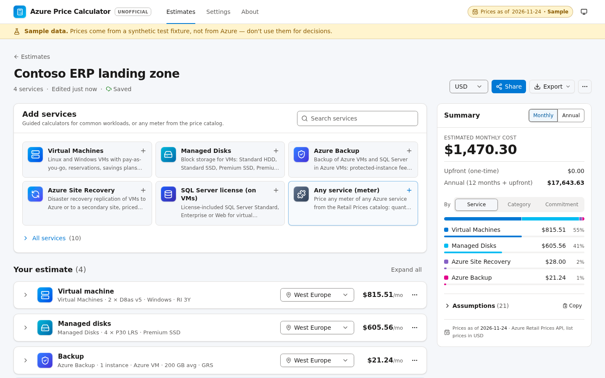
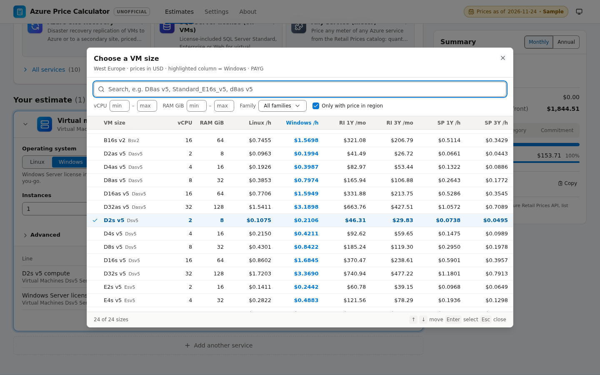
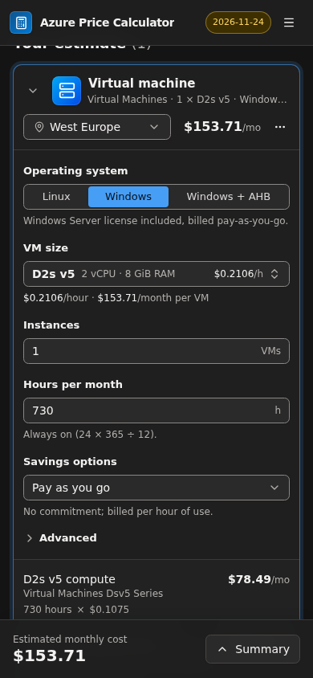

# Azure Price Calculator (unofficial)

A fast, backend-free Azure price calculator that runs entirely in the browser and is hosted on
**GitHub Pages**. It is fed by a **daily snapshot of the Azure Retail Prices API** (published by
[`sbroenne/azureretailprices-exporter`](https://github.com/sbroenne/azureretailprices-exporter)),
which a GitHub Actions workflow downloads, splits into small JSON shards per service and region, and
publishes together with the app.

> Unofficial tool. List (retail) prices only: no EA/MCA/CSP discounts, no Marketplace software,
> no taxes. USD is Microsoft's pricing currency; other currencies are indicative and converted with
> the daily FX snapshot. Always confirm with the [official Azure Pricing Calculator](https://azure.microsoft.com/pricing/calculator/).



<sub>Screenshots use the synthetic sample snapshot (`make data-sample`), not real prices.</sub>

## Features

- **Estimates** like the official calculator: add services, configure region / SKU / quantities /
  hours / commitment, see monthly, upfront, effective (amortized) and annual totals with breakdowns
  by service, category and commitment, plus auto-generated **assumptions** ready to paste.
- **Rich modules**: Virtual Machines (Linux / Windows / Windows + AHB, PAYG, Reserved 1Y/3Y with
  monthly or upfront payment, Savings Plan 1Y/3Y when present in the data, Spot), Managed Disks
  (Standard HDD/SSD, Premium SSD by tier or by size, Premium SSD v2, Ultra), Azure Backup, Azure Site
  Recovery, SQL Server license on VMs, and **Any service (meter)** — a generic fallback that can
  price any meter of the catalog (App Service, Bandwidth, Log Analytics, …) with tiered pricing.
- **Several saved estimates** in `localStorage`, **share by URL** (configuration only, compressed in
  `?s=`), **export** to JSON / CSV / Excel (.xlsx) / Markdown, import JSON, full backup/restore.
- **16+ currencies**, light/dark theme, responsive down to 360 px, keyboard accessible.
- **Official Azure Architecture Icons** (synced by script; generic fallback tiles when absent).
- No backend, no telemetry, no cookies.

<p>
  
  
</p>

## Deploy your own (GitHub Pages)

1. Create an empty GitHub repository and push this project to `main`:
   ```bash
   git init -b main && git add . && git commit -m "Azure price calculator v1"
   git remote add origin https://github.com/<user>/<repo>.git && git push -u origin main
   ```
2. In the repository: **Settings → Pages → Build and deployment → Source: GitHub Actions**.
3. The workflow **Build & Deploy (data + SPA)** runs on every push to `main`, daily at 08:15 UTC and
   on demand (**Actions → Build & Deploy → Run workflow**, optionally with an exporter tag such as
   `prices-2026-11-24`). Its summary shows the data report and the three validation cases.
4. Open `https://<user>.github.io/<repo>/`.

Notes
- The app uses a hash router and relative URLs (`base: "./"`), so it works on project pages,
  user pages and custom domains without configuration.
- GitHub disables scheduled workflows in public repositories after 60 days without activity;
  re-enable it from the Actions tab if that happens.
- If the data build fails (exporter release missing, header change, size limits), nothing is deployed
  and the site keeps serving the previous snapshot. The app shows a warning when the snapshot is
  older than 3 days.

## Local development

Requirements: Node.js ≥ 22.18 (24 recommended), Python ≥ 3.10 (stdlib only). `uv` is optional
(CI uses it); `make` is optional.

```bash
make data-sample          # synthetic sample snapshot -> web/public/data (no network)
# or: make data-real      # latest real export, reduced to 4 regions and 5 services (downloads ~500 MB)
cd web && npm ci && npm run dev
```

| Task | Command |
|---|---|
| Web unit tests | `cd web && npm test` (Node's built-in test runner, TypeScript via type stripping) |
| Type-check + build | `cd web && npm run build` |
| Pipeline tests | `cd pipeline && python3 -m unittest discover -s tests` (CI: `uv run --project pipeline pytest`) |
| Full data build | `PYTHONPATH=pipeline/src python3 -m azcalc_pipeline build --out dist/data` |
| Validation numbers | `python3 scripts/validation_cases.py web/public/data` |
| Azure icons | `python3 scripts/sync_icons.py` (see `web/public/icons/README.md`) |
| VM specs (vCPU/RAM) | `bash scripts/export-vm-skus.sh` (Azure CLI, `az login`) |

## Architecture

```
GitHub repo ── Actions (push / daily cron / manual)
  pipeline/ (Python, stdlib)   download exporter release -> validate -> shard -> indexes -> manifest
  web/      (Vite + React)     build SPA
        │  one Pages artifact (data is never committed to git)
        ▼
GitHub Pages
  /index.html, /assets/*                        SPA (hashed file names)
  /data/manifest.json                           fetched with cache: "no-store" (+ ?t=now)
  /data/<DATE>/index/{services,regions,vm-skus,shards}.json, /data/<DATE>/fx.json
  /data/<DATE>/prices/<service>/<region>[.partN|.spot].json   columnar JSON shards
        ▲  fetch on demand (only the shards an estimate needs)
Browser: zustand + localStorage (estimates, settings) · IndexedDB cache of shards keyed by date
```

- **Freshness**: the manifest is never cached; shard paths contain the snapshot date, so they are
  immutable and cached aggressively (IndexedDB), and purged when the date changes. No service worker.
- **Size**: columnar JSON, Spot/Low Priority split into `.spot.json`, Dev/Test dropped, shards over
  5 MB split into parts; the build fails above 900 MB total or 95 MB per file.
- Sizes and limits: [`docs/data-sizes.md`](docs/data-sizes.md); validation: [`docs/validation.md`](docs/validation.md).
- Contracts: [`docs/data-contract.md`](docs/data-contract.md) (pipeline → SPA),
  [`docs/dev/pricing-api.md`](docs/dev/pricing-api.md), [`docs/dev/platform-api.md`](docs/dev/platform-api.md).

```
.github/workflows/build-and-deploy.yml   test → build data + SPA → deploy
pipeline/                                Python package azcalc_pipeline (+ tests, fixture, region/VM data)
scripts/                                 icons sync, VM specs export, validation cases
web/src/domain/                          pure TS: model (zod), pricing modules, totals, share, exports
web/src/data/                            manifest/catalog/shards loading, IndexedDB cache, React hooks
web/src/store/                           zustand store (persisted, versioned, migrations)
web/src/modules/                         per-service configuration forms
web/src/components, pages/               app shell, estimate editor, summary, dialogs
docs/                                    contracts, validation, data sizes, screenshots
```

## Pricing rules (summary)

- 730 hours/month by default (editable per item); annual = monthly × 12 + upfront.
- VM Windows = Linux compute + Windows license (`Windows − Linux` hourly price). AHB = Linux price.
  Reservations: `retailPrice` is the total for the term → monthly = total / 12 or 36 (or upfront);
  the Windows license is never reserved and is added at PAYG. Savings Plan uses the hourly SP rate.
- Managed Disks are billed per tier; "by size" rounds up to the next tier. Premium SSD v2 includes
  3,000 IOPS and 125 MB/s; Ultra bills all provisioned capacity, IOPS and throughput.
- Backup: protected-instance fee (≤ 50 GB half, 50–500 GB one, > 500 GB per started 500 GB) +
  backup storage by redundancy. Site Recovery: per protected instance (target resources not included).
- SQL Server license: `1-4 vCPU VM` meter, billed linearly per vCPU above 4 (minimum 4 per VM).
- Tiered meters are priced marginally; a meter missing in a region shows "Not available", never 0.

Details and the exact matching rules: [`docs/dev/pricing-api.md`](docs/dev/pricing-api.md).

## Decisions and deviations from the original plan

| Plan | Implemented | Why |
|---|---|---|
| `lz-string` for share links | Native `CompressionStream` (deflate-raw) + base64url in `?s=` | Zero dependencies, better compression. |
| SheetJS/exceljs for XLSX | Small built-in OOXML + ZIP writer | npm builds of SheetJS carry known CVEs; no dependency needed. |
| vitest | `node --test` with native TypeScript type stripping | Zero extra dependencies. |
| fuse.js, @tanstack/react-virtual, idb-keyval | Small in-house search, virtual list and IndexedDB helpers | Fewer dependencies; same behaviour. |
| Cron 05:00 UTC | 08:15 UTC | The exporter publishes around 06:00 UTC. |
| `scripts/sync-icons.ts` + svgo | `scripts/sync_icons.py`, icons copied unchanged and renamed to stable keys; CI runs it best-effort | No Node deps; Microsoft terms forbid altering the icons. |
| Vite `base=/<repo>/` | `base: "./"` (override with `VITE_BASE`) | Works on any Pages URL thanks to the hash router. |

## Limitations

- Retail list prices only; Savings Plan appears only when the exporter CSV contains `SavingsPlans` rows.
- VM vCPU/RAM specs come from `pipeline/data/vm-skus.base.json` (seeded for common families —
  refresh with the Azure CLI script); SKUs without specs are still listed and priced.
- Generic meters need the user to understand the meter's unit (the UI explains it).
- Icon availability depends on the official icon set (no Site Recovery icon exists; a vault icon is used).

## License

MIT for the code (see [LICENSE](LICENSE)). Azure Architecture Icons are © Microsoft and used under
[their terms](https://learn.microsoft.com/azure/architecture/icons/). Not affiliated with or endorsed by Microsoft.
